<!--
  GitHub Profile README · Yassine Aouaj
  Theme: Dark Anime / Samurai
  Palette: #080808 · #151515 · #DC2626 · #991B1B · #F5F5F5

  Original artwork (no third-party characters):
  - assets/samurai-hero.svg  · animated moon glow, sakura petals and embers
  - assets/divider.svg       · animated crimson divider
  - assets/footer.svg        · animated footer

  External services:
  - Readme Typing SVG, Skill Icons, Shields.io
  - GitHub Readme Stats, GitHub Readme Activity Graph

  The contribution snake is generated by .github/workflows/snake.yml and
  published to the "output" branch. The first workflow run creates it.
-->

  

<h1 align="center">Yassine Aouaj</h1>

  

  

  

<h2 align="center">01 · About Me</h2>

  <i>Developer by craft. Creator by instinct.</i>

  I'm Yassine, a developer from <b>Morocco</b> with a background in <b>Computer Science</b> and <b>Web Development</b>.
  I build practical web applications, solve programming problems, and explore how <b>Artificial Intelligence</b>
  can shape better digital experiences.

  Alongside development, I work in <b>video editing</b> and <b>motion graphics</b> — a creative practice that
  shapes how I build and present digital work.

  <b>Web Development</b> · <b>Software Development</b> · <b>Programming</b> 
  <b>Artificial Intelligence</b> · <b>Creative Content</b> · <b>Video Editing</b> · <b>Motion Graphics</b>

<h2 align="center">02 · Tech Stack</h2>

  <i>Languages, tools, and creative software.</i>

<h3 align="center">Programming</h3>

  

  
  

<h3 align="center">Frontend</h3>

  

<h3 align="center">Backend &amp; Database</h3>

  

  

<h3 align="center">Tools</h3>

  

  
  

<h3 align="center">Creative</h3>

  
  
  
   
  
  
  

<h2 align="center">03 · Featured Projects</h2>

  <i>Selected work across management, education, and health.</i>

<!-- Project repository links are intentionally omitted until public URLs exist. -->
<table align="center" width="100%">
  <tr>
    <td width="50%" align="center" valign="top">
      <h3>01 · Yassine Location</h3>
      
Car Rental Management

      
A car rental management application built with PHP and MySQL.

      

        
        
      

    </td>
    <td width="50%" align="center" valign="top">
      <h3>02 · Nour Academy</h3>
      
Educational Management &amp; Student Registration

      
An educational management and student registration platform built with JavaScript, HTML and CSS.

      

        
        
        
      

    </td>
  </tr>
  <tr>
    <td width="50%" align="center" valign="top">
      <h3>03 · UrbanDisplay Manager</h3>
      
Management Application

      
A management application built with PHP and MySQL, using FPDF for document generation.

      

        
        
        
      

    </td>
    <td width="50%" align="center" valign="top">
      <h3>04 · Health Scan Pro</h3>
      
React Application

      
A React application built with a component-based frontend.

      

        
      

    </td>
  </tr>
</table>

  

<h2 align="center">04 · GitHub Statistics</h2>

  <i>Consistency, measured in commits.</i>

  
  

  

<h3 align="center">Contribution Snake</h3>

<!-- Generated by .github/workflows/snake.yml after the first push. -->

  

<h2 align="center">05 · Connect</h2>

  
  
  

 

  

